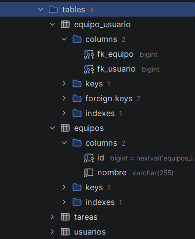

# Documentación técnica de la versión 1.2.0

## Evolución de la aplicación

La versión 1.2.0 incorpora la gestión de equipos. Un equipo agrupa usuarios y se relaciona con ellos mediante una asociación muchos a muchos. La implementación mantiene la arquitectura de las versiones anteriores: los controladores atienden las rutas y preparan el modelo, los servicios concentran las reglas de negocio, los repositorios acceden a JPA y las plantillas Thymeleaf generan las páginas. Además, se ha configurado la integración continua con GitHub Actions y se ha añadido soporte para PostgreSQL.

## Modelo de datos

La entidad `Equipo` contiene el identificador, el nombre y la colección de usuarios. La relación se declara con `@ManyToMany` y una tabla intermedia:

```java
@ManyToMany(fetch = FetchType.LAZY)
@JoinTable(name = "equipo_usuario",
        joinColumns = { @JoinColumn(name = "fk_equipo") },
        inverseJoinColumns = {@JoinColumn(name = "fk_usuario")})
Set<Usuario> usuarios = new HashSet<>();
```

Hibernate crea las tablas `equipos` y `equipo_usuario`. La segunda almacena pares `(fk_equipo, fk_usuario)`, de modo que un usuario puede pertenecer a varios equipos y un equipo puede tener varios usuarios. Como JPA no mantiene sincronizadas ambas caras de la relación, `Equipo.addUsuario(...)` y `Equipo.removeUsuario(...)` actualizan las dos colecciones. La configuración de conexión está en `application-postgres.properties`, mientras que `application.properties` define el perfil de desarrollo con H2 en memoria. El esquema se actualiza con `spring.jpa.hibernate.ddl-auto=update`.



## Servicio de equipos

`EquipoService` ofrece las operaciones `crearEquipo`, `recuperarEquipo`, `findAllOrdenadoPorNombre`, `añadirUsuarioAEquipo`, `usuariosEquipo`, `equiposUsuario`, `eliminarUsuarioDeEquipo`, `modificarNombreEquipo` y `eliminarEquipo`. Los métodos que reciben un identificador lanzan `EquipoServiceException` cuando el equipo o el usuario no existen. `findAllOrdenadoPorNombre` también lanza esa excepción si no hay equipos, por lo que el controlador la captura y muestra un listado vacío en lugar de un error.

Al eliminar un equipo con miembros se detectó un fallo: recorrer `getUsuarios()` con un `for-each` mientras `removeUsuario` modifica esa misma colección provoca `ConcurrentModificationException` con dos o más usuarios. La solución extrae los usuarios uno a uno:

```java
while (!equipo.getUsuarios().isEmpty()) {
    equipo.removeUsuario(equipo.getUsuarios().iterator().next());
}
equipoRepository.delete(equipo);
```

## Rutas y controladores

`EquipoController` expone las siguientes rutas:

| Método | Ruta | Acción |
| --- | --- | --- |
| GET | `/equipos` | Listado de equipos |
| GET | `/equipos/{id}` | Detalle y miembros |
| POST | `/equipos` | Crear equipo |
| POST | `/equipos/{id}/unirse` | Añadir el usuario al equipo |
| POST | `/equipos/{id}/salir` | Quitar el usuario del equipo |
| POST | `/equipos/{id}/renombrar` | Renombrar (solo administrador) |
| POST | `/equipos/{id}/eliminar` | Eliminar (solo administrador) |

La autorización se centraliza en dos métodos privados. `comprobarUsuarioLogeado()` lanza `UsuarioNoLogeadoException` si no hay sesión y devuelve el usuario actual. `comprobarAdministrador()` añade la comprobación del rol y lanza `UsuarioNoAutorizadoException`, con respuesta HTTP 401, cuando el usuario no es administrador. Un equipo inexistente produce `EquipoNotFoundException`, mapeada a HTTP 404. Las acciones POST no confían en que la interfaz oculte los botones: verifican los permisos en el servidor antes de modificar datos.

## Vistas

`listaEquipos.html` incluye el formulario de creación, la tabla de equipos con enlaces al detalle, un mensaje cuando no hay equipos y los avisos de éxito o error. `detalleEquipo.html` muestra los miembros y ofrece los botones de unirse o salir según el atributo `pertenece`, que el controlador calcula comprobando si el identificador del usuario aparece entre los miembros. El panel de administración, protegido con `th:if="${usuarioLogeado.administrador}"`, contiene el formulario de renombrado y el botón de eliminación con confirmación. El fragmento `fragments.html` incorpora el enlace «Equipos» en la barra de navegación.

## Pruebas

`EquipoTest` comprueba la entidad y la relación en la base de datos. `EquipoServiceTest` valida la creación, el orden alfabético, la pertenencia, la recuperación de equipos de un usuario, las excepciones, el renombrado y la eliminación, incluido el caso de un equipo con varios miembros. `EquipoWebTest` usa MockMvc para verificar el listado, el detalle, la creación, la unión y salida, el flujo completo de cambio de botón, las restricciones de administrador, las respuestas 401 y 404, y la visibilidad del panel administrativo. La suite completa suma 97 pruebas.

## Integración continua

El flujo `Developer Tests` ejecuta `./mvnw test` sobre un contenedor `eclipse-temurin:17-jdk-alpine`, usando la base de datos H2 del perfil de desarrollo. El flujo `Integration tests` levanta un servicio PostgreSQL 13 con las credenciales del proyecto y ejecuta los tests con el perfil `postgres`, de modo que las pruebas se realizan contra un servidor real. Ambos flujos se lanzan en cada push y en cada pull request, y la conexión se configura mediante las variables `POSTGRES_HOST`, `POSTGRES_USER`, `POSTGRES_PASSWORD` y `POSTGRES_DB`.
